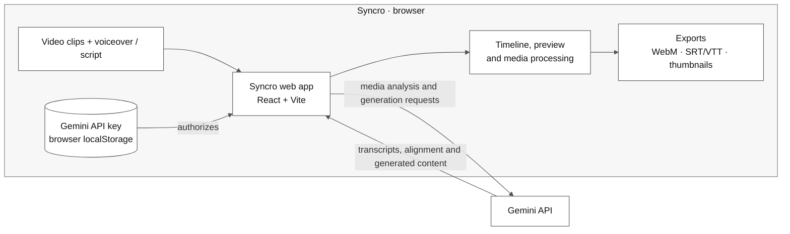

# Syncro

**Turn raw footage and narration into a timed, editable video cut.**

Syncro is an AI-assisted video editing workspace. Add video clips and a voiceover; Gemini analyzes the content and suggests an order aligned to the narration. Review the result on a timeline, refine it, and export.

## What you can do

- Align and reorder clips against an uploaded or AI-generated voiceover.
- Generate narration from a script or from the content of your clips.
- Edit timing, preview captions, and generate descriptions, chapters, and thumbnail candidates.
- Export a combined WebM video, SRT/VTT captions, and thumbnail images.

## Architecture



## Run locally

**Requirements:** Node.js and npm.

```bash
npm install
npm run dev
```

Set a Gemini API key using the key icon in the app. The key is stored in this browser's local storage. Video and audio files sent for AI analysis are uploaded to the Gemini API.

```bash
npm run build
npm run lint
```
